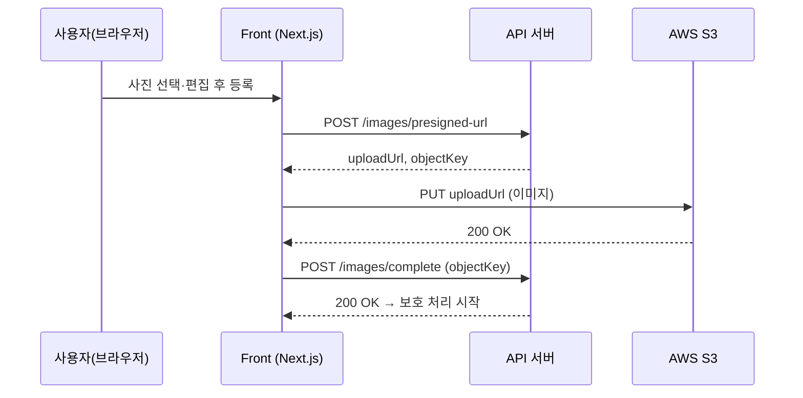

# DeepFence Front

> 올리기 전에 DeepFence가 먼저 살펴볼게요

SNS에 사진을 올리기 전에 **얼굴에는 딥페이크 방어 노이즈를 입히고**, **차량 번호·신분증 같은 개인정보는 블러 처리**해 주는 모바일 웹 서비스 DeepFence의 **프론트엔드** 저장소입니다.

- 서비스: https://www.deepfence.site
- API 서버: https://api.deepfence.site ([Swagger](https://api.deepfence.site/swagger-ui/index.html))
- 서비스 전체 소개: [Codyssey-ROOT](https://github.com/Codyssey-ROOT)

| 저장소                                                                        | 역할                              |
| ----------------------------------------------------------------------------- | --------------------------------- |
| **codyssey-front**                                                            | 모바일 웹 클라이언트 (Next.js)    |
| [codyssey-back](https://github.com/Codyssey-ROOT/codyssey-back)               | API 서버 (Spring Boot)            |
| [deepfence-blur](https://github.com/Codyssey-ROOT/deepfence-blur)             | 개인정보 탐지·블러 서버 (FastAPI) |
| [deepfence-faceshield](https://github.com/Codyssey-ROOT/deepfence-faceshield) | 딥페이크 방어 노이즈 GPU 워커     |

---

## 목차

1. [주요 화면](#1-주요-화면)
2. [기술 스택](#2-기술-스택)
3. [프론트엔드 구현 포인트](#3-프론트엔드-구현-포인트)
4. [폴더 구조](#4-폴더-구조)
5. [실행 방법](#5-실행-방법)
6. [협업 방식](#6-협업-방식)
7. [외부 자원 활용 내역](#7-외부-자원-활용-내역)

---

## 1. 주요 화면

```
사진 선택 → 1:1 편집 → 등록 → 보호 처리(얼굴 노이즈 + 개인정보 블러)
        → 필터링 전/후 비교 → 저장·공유
        → 새 취약점 발견 시 알림 → 재점검
```

| 화면          | 내용                                                                         | 경로               |
| ------------- | ---------------------------------------------------------------------------- | ------------------ |
| 온보딩·로그인 | 서비스 소개 슬라이드 후 카카오 계정으로 시작                                 | `/`                |
| 사진 등록     | 앨범·카메라에서 사진을 고르고 1:1 자르기, 회전, 좌우 반전 후 등록            | `/photo/edit`      |
| 보호 현황 홈  | 취약점 발생 / 모델링 진행중 / 전체 목록을 상태 배지와 함께 표시, 무한 스크롤 | `/home`            |
| 사진 상세     | 필터링 전·후 비교, 보호 결과 안내, 저장·공유, 재점검                         | `/photo/[photoId]` |
| 알림          | 보호 완료, 처리 오류, 새 취약점 발견 알림 목록                               | `/notifications`   |
| 내 정보       | 프로필, 알림 권한, 로그아웃, 회원 탈퇴                                       | `/myPage`          |

## 2. 기술 스택

| 구분            | 기술                                            | 선택 이유                                                                             |
| --------------- | ----------------------------------------------- | ------------------------------------------------------------------------------------- |
| 언어            | TypeScript 5.9 (strict)                         | DTO와 API 응답을 타입으로 고정해 백엔드 연동 오류를 컴파일 단계에서 차단              |
| 프레임워크      | Next.js 16 (App Router, Turbopack), React 19    | 라우트 단위 로딩·에러 화면, `next/image` 최적화, React Compiler로 메모이제이션 자동화 |
| 서버 상태       | TanStack Query 5                                | Query Key 기반 캐싱, `useInfiniteQuery` 무한 스크롤, 업로드·재점검 후 목록 무효화     |
| 클라이언트 상태 | Zustand 5                                       | 편집 중인 사진과 토스트처럼 화면을 넘나드는 작은 상태만 관리                          |
| 스타일          | Tailwind CSS 4, tw-animate-css                  | Figma 디자인 토큰을 CSS 테마 변수로 옮겨 색상·간격·타이포그래피 통일                  |
| UI 컴포넌트     | Base UI, class-variance-authority, lucide-react | 접근성이 갖춰진 Headless 컴포넌트에 디자인 시스템 변형(variant)을 입힘                |
| 사진 편집       | react-easy-crop, Canvas API                     | 자르기 영역 선택은 라이브러리, 회전·반전·원본 해상도 출력은 Canvas로 처리             |
| 폰트            | Pretendard (Variable)                           | `next/font/local`로 자체 호스팅해 레이아웃 흔들림 방지                                |
| 문서·테스트     | Storybook 10, Vitest 4, Playwright              | 공통 컴포넌트를 스토리로 문서화하고 브라우저 환경에서 접근성 검사                     |
| 코드 품질       | Oxlint, Oxfmt, Husky, lint-staged               | Rust 기반 린터·포매터로 빠른 검사, 커밋 전 자동 실행                                  |
| CI              | GitHub Actions                                  | PR마다 린트·포맷·타입 검사·빌드                                                       |
| 배포            | Vercel                                          | `main` 브랜치 자동 배포, PR마다 Preview 배포                                          |

## 3. 프론트엔드 구현 포인트

### 사진 편집기

`react-easy-crop`에서 자르기 영역 좌표만 받고, 회전·좌우 반전·원본 해상도 크롭·JPEG 출력은 Canvas로 직접 구현했습니다. 미리보기는 가볍게, 결과물은 원본 화질로 만듭니다. (`src/utils/image.ts`, `src/hooks/photo/usePhotoEditor.ts`)

### S3 Presigned URL 직접 업로드

이미지 파일이 API 서버를 거치지 않도록 브라우저에서 S3로 바로 올립니다.



재점검도 같은 흐름을 재사용해, 원본 `objectKey`로 완료 통보를 다시 보내 보호 처리를 재시작합니다. (`src/apis/photo/upload.ts`, `src/apis/photo/api.ts`)

### 쿠키 기반 인증 클라이언트

`fetch` 래퍼 하나로 모든 요청을 처리합니다. 토큰은 HttpOnly 쿠키로만 주고받아 스크립트에서 접근할 수 없고, 401 응답을 받으면 토큰 재발급을 한 번만 요청(single-flight)한 뒤 실패했던 요청들을 다시 보냅니다. (`src/lib/api/http-client.ts`)

### 상태 배지와 상세 진입

전체 목록, 진행중 목록, 취약 목록을 함께 불러와 사진마다 배지를 계산합니다. 상세로 들어가기 전에 보호 처리된 이미지가 있는지 먼저 확인해, 빈 화면 대신 안내 토스트를 보여줍니다. (`src/app/(main)/home/page.tsx`)

### 디자인 시스템

Figma 변수를 Tailwind CSS v4 테마 토큰으로 옮기고, Base UI + cva 조합으로 버튼·다이얼로그·탭·토스트 등 공통 컴포넌트를 만들었습니다. 온보딩 일러스트와 빈 화면 이미지도 SVG로 직접 제작했습니다. (`src/styles/`, `src/components/common/`, `src/assets/images/`)

## 4. 폴더 구조

```
src/
├── app/          # 페이지 (App Router), 공통 loading / error / not-found
├── apis/         # 도메인별 API 함수와 Query Key (auth, user, photo, notification)
├── assets/       # 로고, 온보딩 일러스트 등 이미지
├── components/   # common(공통 UI), home, photo, notification, onboarding
├── const/        # 서비스 공통 상수
├── hooks/        # 도메인별 커스텀 훅
├── lib/api/      # fetch 기반 HTTP 클라이언트
├── store/        # Zustand 스토어 (편집 중 사진, 토스트)
├── styles/       # Tailwind 테마와 디자인 토큰
├── types/        # DTO 타입
└── utils/        # 이미지 처리 등 유틸
```

## 5. 실행 방법

### 사전 준비

- Node.js **22 이상**
- pnpm **11** (`corepack enable`로 활성화 가능)

### 설치

```bash
git clone https://github.com/Codyssey-ROOT/codyssey-front.git
cd codyssey-front
pnpm install
```

### 환경 변수

```bash
cp .env.example .env.local
```

| 변수                       | 설명          | 예시                         |
| -------------------------- | ------------- | ---------------------------- |
| `NEXT_PUBLIC_API_BASE_URL` | API 서버 주소 | `https://api.deepfence.site` |

### 실행

```bash
pnpm dev
```

[http://localhost:3000](http://localhost:3000)에서 확인할 수 있습니다. 로그인 이후 기능은 아래 로컬 HTTPS 환경에서 확인해 주세요.

### 로그인까지 확인하려면 (로컬 HTTPS)

인증 토큰은 `deepfence.site` 도메인의 HttpOnly 쿠키로 발급됩니다. 브라우저가 쿠키를 보내도록 같은 사이트(`local.deepfence.site`)의 HTTPS로 실행합니다.

1. `/etc/hosts`에 한 줄 추가

   ```
   127.0.0.1 local.deepfence.site
   ```

2. [mkcert](https://github.com/FiloSottile/mkcert)로 인증서 생성

   ```bash
   mkcert -install
   mkdir -p certificates
   mkcert -key-file certificates/local.deepfence.site-key.pem -cert-file certificates/local.deepfence.site.pem local.deepfence.site
   ```

3. 실행 후 `https://local.deepfence.site:3000` 접속

   ```bash
   pnpm dev:local
   ```

### 빌드 및 검사

```bash
pnpm build && pnpm start   # 프로덕션 빌드 후 실행
pnpm lint                  # 린트
pnpm type-check            # 타입 검사
pnpm test                  # Storybook 스토리 테스트 (Vitest + Playwright)
pnpm storybook             # 컴포넌트 문서 (http://localhost:6006)
```

## 6. 협업 방식

- **이슈 기반 개발**: 기능마다 이슈를 만들고 `type/#이슈번호-작업내용` 브랜치에서 작업 (예: `feat/#30-upload-image`)
- **커밋 컨벤션**: `feat: 제목` 형식, Husky가 브랜치의 이슈 번호를 커밋 끝에 자동으로 붙임
- **PR 리뷰**: PR 템플릿(관련 이슈, 구현 내용, 구현 영상, 확인 사항) 작성 후 `develop`에 Squash Merge
- **CI·배포**: 모든 PR에서 린트·포맷·타입 검사·빌드를 통과해야 머지하고, `develop`에서 검증한 내용을 `main`으로 Merge Commit 하면 Vercel이 운영 환경에 배포
- **문서화**: 폴더 구조, 네이밍, API, 훅, 디자인 시스템, 아이콘, 커밋 규칙을 `.claude/rules/`에 정리하여 팀 공통 기준으로 사용

## 7. 외부 자원 활용 내역

프론트엔드에서 사용한 자원만 정리했습니다. 서버·AI 쪽 자원은 각 저장소의 README를 참고해 주세요.

| 구분           | 명칭                                        | 용도                                          | 라이선스                      |
| -------------- | ------------------------------------------- | --------------------------------------------- | ----------------------------- |
| 오픈소스       | Next.js 16.4                                | 웹 프레임워크                                 | MIT                           |
| 오픈소스       | React 19.3                                  | UI 라이브러리                                 | MIT                           |
| 오픈소스       | TanStack Query 5.105                        | 서버 상태 관리, 무한 스크롤                   | MIT                           |
| 오픈소스       | Zustand 5.0                                 | 클라이언트 상태 관리                          | MIT                           |
| 오픈소스       | Base UI 1.9                                 | 접근성 기반 UI 컴포넌트(다이얼로그, 탭, 토글) | MIT                           |
| 오픈소스       | react-easy-crop 6.2                         | 사진 자르기 영역 선택                         | MIT                           |
| 오픈소스       | Tailwind CSS 4.3, tw-animate-css 1.4        | 스타일링, 애니메이션                          | MIT                           |
| 오픈소스       | class-variance-authority 0.7                | 컴포넌트 변형 스타일                          | Apache 2.0                    |
| 오픈소스       | lucide-react 1.63                           | 아이콘                                        | ISC                           |
| 오픈소스       | Pretendard 1.3                              | 폰트                                          | OFL 1.1                       |
| 오픈소스       | shadcn 4.23                                 | 컴포넌트 구성 CLI                             | MIT                           |
| 오픈소스       | Storybook 10.6, Vitest 4.1, Playwright 1.64 | 컴포넌트 문서화, 테스트                       | MIT / MIT / Apache 2.0        |
| 오픈소스       | Oxlint 1.90, Oxfmt 0.75, Husky 9.1          | 린트, 포맷, Git 훅                            | MIT                           |
| 외부 API       | 카카오 로그인 (OAuth 2.0)                   | 소셜 로그인 (API 서버 경유)                   | 상용 API (카카오 개발자 약관) |
| 외부 서비스    | AWS S3, CloudFront                          | 사진 업로드, 보호된 사진 표시                 | 상용                          |
| 외부 서비스    | Vercel                                      | 프론트엔드 호스팅, 자동 배포                  | 상용                          |
| 사전 보유 코드 | 해당 없음                                   | 첫 커밋 2026-10-30 12:46 (주제 공개 이후)     | -                             |
| 기타           | Figma                                       | UI 디자인, 디자인 토큰                        | 상용                          |
| 기타           | Claude Code (Anthropic)                     | AI 코딩 보조 도구                             | 상용                          |
